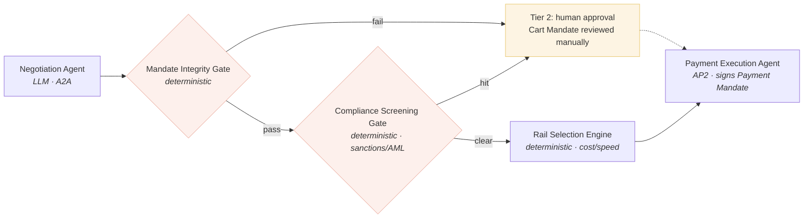

# Corridor

**Agentic trade settlement for cross-border SMEs, built on Google's A2A and AP2 protocols.**


A gated, single-responsibility agent system where one SME's procurement agent negotiates a purchase directly with a supplier's agent over **A2A**, and settles it through a cryptographically signed **AP2** Mandate chain — with every negotiated term independently re-verified before a payment is ever authorized.

Every architectural claim here is checked against a specific, cited regulatory obligation across three jurisdictions. Nothing is asserted as compliant without naming the article, act, or standard it answers to.

---

## The problem, in one paragraph

SMEs pay over 5% of transaction value on cross-border B2B payments — more than double what large corporates pay — and 62% report delays and added cost from navigating upward of 190 different regulatory regimes. The friction isn't a missing feature in any one bank's product; it's that the commercial negotiation and the payment authorization live in two disconnected worlds, connected only by a person retyping numbers between an email thread and a payment portal. Corridor closes that gap structurally, using the protocol Google built specifically for agent-to-agent commerce.

## Why A2A + AP2, specifically

This isn't "an AI agent that pays things." [A2A](https://a2a-protocol.org) is Google's open standard for agent-to-agent communication and negotiation; [AP2](https://ap2-protocol.org) is Google's open standard for what happens once that negotiation needs to become a real, authorized, non-repudiable payment — a chain of signed Mandates (Intent → Cart → Payment) built as W3C Verifiable Credentials. Corridor composes both exactly as they're designed to be composed: A2A negotiates, AP2 settles.

A recent independent red-teaming study of AP2 found the protocol cryptographically secures **what** gets executed, but doesn't constrain **how** the mandate was constructed during negotiation — meaning a compromised or prompt-injected negotiation could still produce a validly signed, badly wrong Cart Mandate. Corridor's Mandate Integrity Gate exists specifically to close that gap. That finding — not a hypothetical — is the reason this system looks the way it does.

## Live artifact

`corridor-design-doc.html` is a self-contained, interactive living design document — no build step, no dependencies. Open it directly in a browser, or serve it via GitHub Pages. It includes:

- A full client brief, stakeholder map, and problem statement for the fictional anchor client, **Farside Payments**
- An interactive **agent-trace simulator** — run a routine in-policy settlement end to end, then run a second case where a negotiated price drifts outside the pre-authorized ceiling and watch the Mandate Integrity Gate halt it before signature
- The full regulatory obligation mapping, ADR set, and rollout roadmap referenced below

```
open corridor-design-doc.html
# or, for a shareable link:
# push to a gh-pages branch and serve via GitHub Pages
```

## Architecture

Five components. Each does exactly one job. Nothing auto-signs a payment without passing through a gate that doesn't trust the component before it.



| Component | Type | Single responsibility |
|---|---|---|
| Negotiation Agent | LLM, A2A-speaking | Negotiate terms with the counterparty's agent within Intent Mandate bounds |
| Mandate Integrity Gate | Deterministic | Independently re-derive whether the negotiated Cart Mandate satisfies the original Intent Mandate — never trusts the Negotiation Agent's own report |
| Compliance Screening Gate | Deterministic | Sanctions / AML screening, isolated and independently testable |
| Rail Selection Engine | Deterministic | Choose the cheapest, fastest available settlement rail for the corridor — never an LLM judgment call |
| Payment Execution Agent | AP2 | Sign and submit the Payment Mandate; nothing upstream of this can sign a payment directly |

**On trust, specifically:** the Mandate Integrity Gate is deliberately designed to distrust the component immediately upstream of it. The Negotiation Agent's context window is the surface most exposed to a counterparty's input — so the gate re-derives compliance from the raw negotiated terms, not from what the Negotiation Agent says it agreed to.

## Design principles

1. **Single responsibility, always.** No component does more than one job. A negotiation agent negotiates; it does not also decide whether the deal is safe.
2. **Deterministic where a wrong answer is expensive.** Rail selection and integrity checking are plain code against known parameters — never an LLM asked to "judge" a financial outcome.
3. **Gates don't trust their inputs.** Every gate independently re-verifies against ground truth rather than consuming an upstream agent's summary.
4. **Human oversight sits where the human already gave authority — not everywhere by default.** Corridor doesn't require a signature on every transaction; it requires strict adherence to the bounds the human already set via the Intent Mandate, and routes anything outside those bounds to a person. That's a deliberate, load-bearing design choice, argued for explicitly in [ADR-CR-03](corridor-design-doc.html#s10).
5. **Observability is one log table, not a platform.** AP2 already provides cryptographic non-repudiation. Corridor's logging adds operational visibility on top — gate decisions, rail choice, timing — feeding the existing treasury dashboard rather than standing up a parallel system.

## Regulatory grounding — three jurisdictions, one transaction

A UK buyer settling with an EU supplier over a stablecoin rail touches all three, and this document names the specific obligation each mechanism answers to rather than gesturing at "compliance" generally.

| Jurisdiction | Instrument | What it requires | Where Corridor answers it |
|---|---|---|---|
| 🇬🇧 UK | FCA / Payment Systems Regulator | Payment initiation conduct standards | Payment Execution Agent operates inside Farside's existing authorization |
| 🇪🇺 EU | MiCA | Oversight of crypto-asset activity | Rail Selection Engine's stablecoin routing is logged and reviewable; classification question flagged open, not assumed |
| 🇪🇺 EU | AI Act, Art. 50 | Transparency when an AI system interacts with a person | Counterparty is informed it's negotiating with an agent |
| 🇺🇸 US | GENIUS Act | BSA/AML + OFAC obligations at the stablecoin issuer level; proposed 2-day redemption SLA | Compliance Screening Gate runs sanctions checks independent of the issuer's own program; redemption timing is monitored |

The GENIUS Act line is the one worth reading twice: **there is no US counterparty anywhere in this transaction.** The obligation arrives anyway, because the stablecoin most likely used to settle it is issued by a US-regulated entity. Stablecoin rails don't bypass regulation — they relocate it to the issuer layer. This document treats that as a design input, not a footnote.

## Architecture Decision Records

Six ADRs, each with rejected alternatives named explicitly — not just the decision that won:

- **ADR-CR-01** — Five single-responsibility gated components, not one end-to-end agent or a larger composite platform
- **ADR-CR-02** — Rail Selection Engine is deterministic, never LLM-scored
- **ADR-CR-03** — Tier 1 delegated execution permitted only strictly within the original Intent Mandate — the one deliberate divergence from this portfolio's other, always-human-signs design (see below)
- **ADR-CR-04** — Mandate Integrity Gate never trusts the Negotiation Agent's self-report
- **ADR-CR-05** — Compliance screening is a separate deterministic step, never folded into an LLM's reasoning
- **ADR-CR-06** — One structured event log, feeding an existing dashboard, not a new observability platform

Full rationale for each lives in [`corridor-design-doc.html`, §10](corridor-design-doc.html#s10).

## What's built vs. what's designed — stated plainly

This is a systems-design and protocol-literacy portfolio piece, not a production deployment, and it's more useful to you if that's clear up front rather than discovered in conversation:

- ✅ Full architecture, ADRs, regulatory obligation mapping, and rollout roadmap — complete
- ✅ Interactive agent-trace simulator demonstrating both the happy path and the integrity-gate failure path — complete, runs client-side, no backend
- ⬜ Real A2A negotiation session against a live counterparty agent — not built
- ⬜ Real AP2 Mandate signing and settlement — not built
- ⬜ Production Compliance Screening Gate against a live sanctions list — not built

The honest reason: A2A and AP2 are genuinely new (AP2 v0.2 shipped April 2026), counterparty agents to negotiate against in the wild are scarce, and a system touching real sanctions screening and real payment rails is not something to stand up carelessly as a demo. What's here is the design work that should precede that build — the same discipline a real engineering team would want to see before writing the first line of settlement code.

## Rollout roadmap

| Phase | Scope |
|---|---|
| **1** | One corridor (UK–EU), one allowlisted counterparty. Negotiation Agent, Mandate Integrity Gate, and Compliance Screening Gate live. Settlement via SEPA Instant only — no stablecoin rail yet, to isolate the negotiation-and-mandate model from the MiCA/GENIUS questions entirely |
| **2** | Stablecoin rail added to Rail Selection Engine, contingent on a MiCA classification determination. GENIUS-side redemption SLA monitoring added |
| **3** | Expand counterparty allowlist and corridor set; extend beyond routine reorders to first-time negotiations, with a correspondingly narrower Tier 1 eligibility band |

## Part of a four-project portfolio

Corridor is the fourth of four living design documents built on the same design system, each targeting a different regulated financial-services workflow:

| Project | Domain | Regulatory anchor |
|---|---|---|
| **SLUDGE** | Consumer Duty outcomes monitoring | UK FCA Consumer Duty |
| **Vantage** | Commercial insurance claims (FNOL) | UK FCA ICOBS |
| **Lumen** | Life & health underwriting | EU AI Act, Annex III(5)(c) |
| **Corridor** | Cross-border SME trade settlement | UK PSR · EU MiCA/AI Act · US GENIUS Act |

Corridor and Lumen intentionally diverge on one point — Lumen requires a human signature on every case; Corridor allows unattended execution strictly within a pre-authorized Intent Mandate. That's not an inconsistency; it's two different domains with two different legitimate sources of human authority, and both documents say so explicitly rather than leaving the reader to notice the gap.

## Disclaimer

Farside Payments, Halvorsen & Cole Fabrication, BrunnerTeknik GmbH, and every named individual in this repository are fictional constructs built for this portfolio. The A2A and AP2 protocol specifications, and the EU AI Act, MiCA, UK payment services regulation, and US GENIUS Act references, are real and current as of mid-2026. Nothing here constitutes legal, regulatory, or financial advice — the obligation mapping is a starting point for a real conformity assessment, not a substitute for one.

## Author

Built as a portfolio artifact demonstrating applied AI systems design against real Google protocols and real, cited financial-services regulation across the UK, EU, and US.

---

<sub>License: MIT. Use, adapt, or fork freely.</sub>
